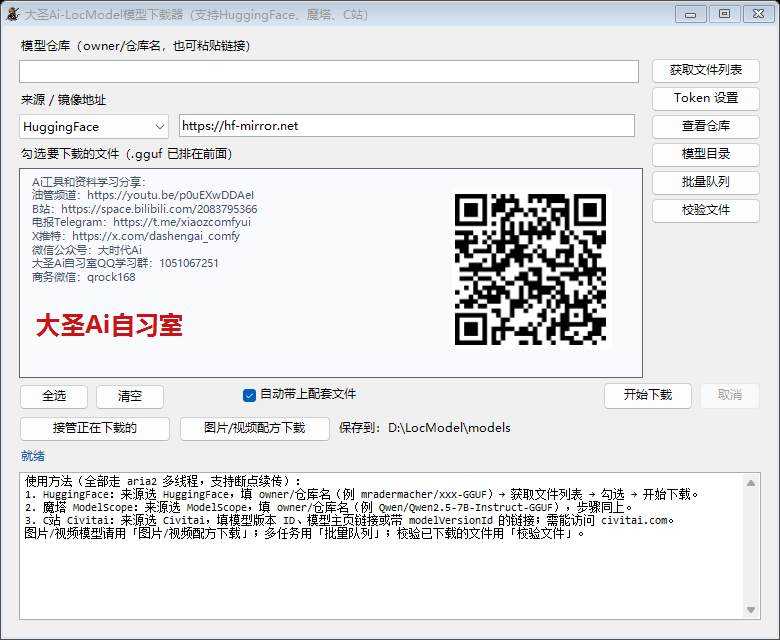
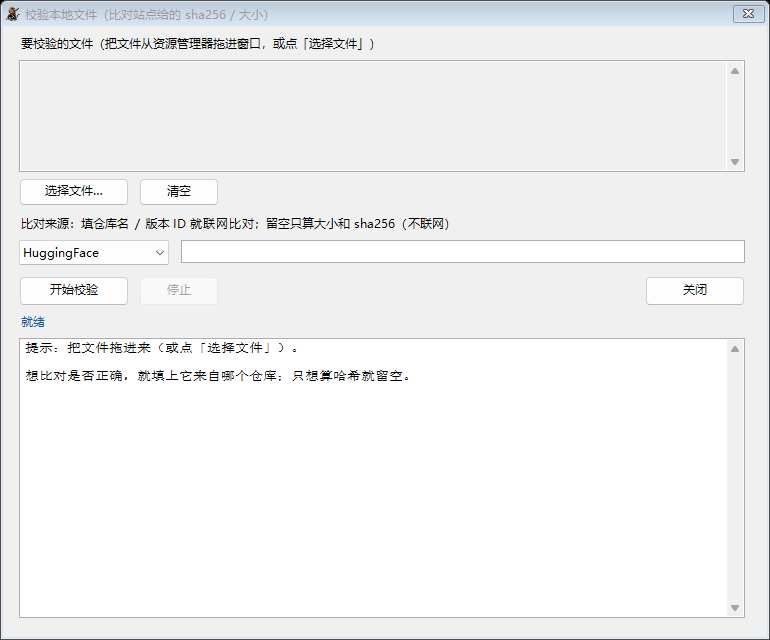

# 大圣Ai · LocModel 模型下载器

给 [LocModel](https://locmodel.com/) 这类本地模型运行器配的模型下载工具（Windows）。可以同时从 **HuggingFace、魔塔 ModelScope、C站 Civitai** 三站下载，全部走 `aria2c` 多线程，支持断点续传、批量排队、下载后校验。

LocModel 官网：<https://locmodel.com/>

当前版本 **1.1.6** · [下载最新版](../../releases/latest) · [更新记录](#更新记录)



## 功能

- **三来源**：HuggingFace（可换镜像）、魔塔 ModelScope、C站 Civitai；支持粘贴仓库页 / 文件页 / 模型页链接
- **粘链接自动认来源**：贴 `modelscope.cn` 自动切魔塔、`civitai.com` 自动切 C站、`huggingface.co` 自动切 HF；粘文件页链接会直接定位到那个文件。主界面、批量队列、校验窗、命令行都走同一套识别
- **批量队列**：三种来源可以混在一个队列里，重复任务自动跳过；按顺序下载，可暂停全部、取消单项，关掉重开自动续传
- **自动配齐**：勾选 `.gguf` 主体时自动带上同仓库的 `mmproj` 和多分片
- **图片 / 视频模型配方**：按「主体 + 文本编码器 + VAE」三件套一次下齐，放到 LocModel 认的目录
- **接管未完成下载**：LocModel 自己下的 `.part` 半成品，可以交给本工具用 aria2 重新接管
- **下载后校验**：默认比对文件大小；`verify=hash` 时再算 sha256（HF 的 `lfs.sha256`、魔塔的 `Sha256`、C站的 `hashes.SHA256`），坏文件直接删掉重下
- **自动装引擎**：找不到 aria2c.exe 时会问你要不要自动下载安装（官方 aria2 1.37.0，约 2.4 MB，装好后校验 SHA256）
- **本地文件校验**：把已有模型拖进「校验文件」窗口，跟站点元数据比对，判断文件是否完整
- **便携**：解压即用，数据写在程序目录 `data\`，不需要管理员权限；单实例运行



## 系统要求

- 64 位 Windows 10 / 11
- .NET Framework 4.x（系统自带，不用装）
- `aria2c.exe` 下载引擎：便携包已内置；用单文件版时程序会问你要不要自动下载安装（约 2.4 MB）

## 使用

1. 从 [Releases](../../releases) 下载便携包，解压到任意目录
2. 双击 `LocModel模型下载器.exe`（首次运行 SmartScreen 提示时点「更多信息 → 仍要运行」）
3. 来源选 HuggingFace / ModelScope / Civitai，填 `owner/仓库名` 或版本 ID，点「获取文件列表」
4. 勾选文件 →「开始下载」；多任务用「批量队列」

详细说明见 [使用说明.txt](使用说明.txt)。

## 命令行

```
LocModel模型下载器.exe --doctor            # 环境自检
LocModel模型下载器.exe --selftest          # 内置回归测试
LocModel模型下载器.exe --issues [目录]     # 检查图片/视频模型是否配套
LocModel模型下载器.exe --cleanparts        # 清理残留 .part
LocModel模型下载器.exe --findmodels        # 模型目录探测
LocModel模型下载器.exe --queue             # 查看队列
LocModel模型下载器.exe --addqueue <仓库> [文件]   # 加队列（仓库可带 ms:/cv: 前缀）
LocModel模型下载器.exe --verify <文件> [仓库]     # 校验本地文件（0 一致 / 1 不一致 / 3 无法比对）
LocModel模型下载器.exe --installaria             # 自动下载安装 aria2（校验 SHA256）
LocModel模型下载器.exe --to <仓库> <文件> <目录>  # 单文件下载（含校验）
LocModel模型下载器.exe --recipe <id> [量化]       # 查看配方要下的文件
```

程序是窗口程序，在 cmd 里会挂到当前控制台输出，但 cmd 不会等它结束；批处理里请用 `start /wait`。

## 从源码构建

```bat
build.cmd
```

产物是同目录下的 `LocModelDownloader.exe`（和便携包里的中文名程序是同一个，改名不影响）。需要 `csc.exe`（.NET Framework 4 自带，路径 `%WINDIR%\Microsoft.NET\Framework64\v4.0.30319\`）。源码是单文件 `LocModelDownloader.cs`，无第三方 NuGet 依赖。

界面上的猴子图标和右侧二维码是可选资源：把 `app.ico`（窗口图标）和 `brand_qr.png`（二维码）放到 `build.cmd` 旁边，脚本会自动编进去；不放也能编译，只是没有图标和二维码。

```
LocModelDownloader.cs   全部源码（约 4000 行）
recipes.json            图片/视频模型配方表（可自己增改）
config.txt              并发数 / 代理 / 校验强度
使用说明.txt             面向使用者的说明
LICENSE-aria2.txt       aria2 的 GPLv2 许可声明
screenshots/            界面截图
```

## 已知限制

- 路径超过 260 字符会失败（.NET Framework 4 限制）
- 不支持 32 位系统（内置 aria2 为 x64）
- 图片/视频模型只认 LocModel 内置的 10 条管线，表外模型工具无法让它识别
- LocModel 的 `.part` 没有控制文件，无法续传，只能重下
- HuggingFace 只有大文件（LFS）提供 sha256，小配置文件只能比大小
- 下载时令牌会出现在 aria2 的命令行参数里，同机其他进程理论上可见（单用户机器风险低）

## 更新记录

**1.1.7**
- 新增：找不到 aria2c.exe 时自动下载安装（aria2 官方 1.37.0，SHA256 校验后装到数据目录 `aria2\`）；启动和每次下载前都会检查
- 命令行新增 `--installaria`，可手动触发安装

**1.1.6**
- 修复：下载完成等提示框可能弹到主窗口后面，导致界面像卡死（全部 42 处对话框改为挂当前窗口显示）

**1.1.5**
- 修复：来源识别只在主窗口生效，批量队列 / 校验窗 / 命令行把魔塔、C站链接误当成 HuggingFace；现在四处入口统一按域名识别

**1.1.4**
- 新增：粘文件页链接自动勾选对应文件；支持 `hf:` / `ms:` / `cv:` 前缀；不支持的网站给出明确提示

**1.1.3**
- 修复：把文件名 / 网页路径当仓库名时提示不清；401 不再一律弹「需要令牌」，而是列出仓库名错误 / 私有仓库 / 令牌三种原因

**1.1.2**
- 修复：品牌二维码没有编进程序

## 问题反馈

有 bug 或建议请开 Issue：<https://github.com/dsAI-Q/locmodel-downloader/issues>

已知待修项（都在 Issues 里）：网络请求无重试、令牌经 aria2 命令行可见、校验按文件名匹配的同名歧义、长路径、高 DPI 模糊、目录选择校验、预检只查 12 个链接、自检不覆盖真实下载、站内搜索。

## 致谢

- [aria2](https://github.com/aria2/aria2)：GPLv2+，本工具仅通过命令行调用，未修改其源码，许可见 `LICENSE-aria2.txt`
- 各模型站点提供的公开 API

## 免责声明

本工具只负责下载文件，不提供模型，也不修改 LocModel 程序本身。模型版权归各自作者所有，使用时请遵守 HuggingFace / ModelScope / Civitai 的服务条款。源码为作者原创，未声明开源许可证，转载或二次分发请注明出处。
